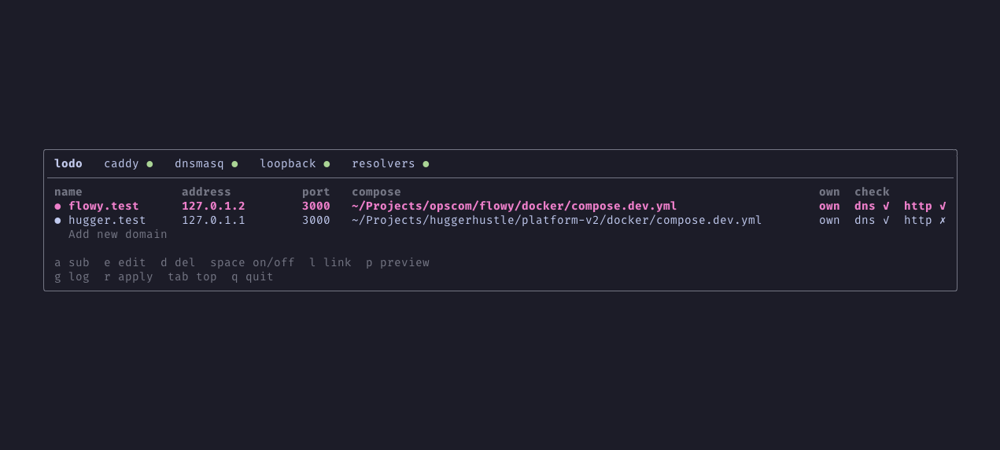

# lodo

Run several projects on one Mac at once, each database and app on its usual port. Every project gets its own
loopback address and a `.test` name, so media's Postgres listens on `127.0.1.3:5432` while blog's listens on
`127.0.1.1:5432`. lodo drives dnsmasq, macOS's `/etc/resolver` files and Caddy for you.



```text
media.test -> 127.0.1.3 -> 127.0.1.3:5432 (Postgres), 127.0.1.3:3000 (Next)
blog.test  -> 127.0.1.1 -> 127.0.1.1:5432 (Postgres)
http://dashboard.blog.test -> Caddy on port 80 -> 127.0.1.1:3000
```

Full details: [docs/reference.md](docs/reference.md).

## Install

Needs macOS on Apple Silicon with Homebrew in `/opt/homebrew`, Go 1.27+, and an admin account.
Never test on Linux but I think it's easy to get it works there.

```sh
brew install dnsmasq caddy                          # caddy only for names with a port
go install github.com/sangdth/lodo/cmd/lodo@latest  # ~/go/bin must be on your PATH
lodo setup                                          # once per Mac; asks for your password once
```

Setup backs up and edits Homebrew's `dnsmasq.conf` and `Caddyfile`, adds `127.0.1.1`–`127.0.1.50` to `lo0`,
and installs a sudoers rule for one root script, so later changes never ask for a password. Running it again is
safe. Run it again after you install Caddy, turn on the first HTTPS name, or when `lodo doctor` says
"script out of date". [What setup changes](docs/reference.md#setup).

## Use

```sh
cd ~/Projects/shop
lodo dev          # first run opens the setup form; later runs start the apps on their names
lodo dev --edit   # open the setup form again
lodo dev -y       # save what lodo proposes with no form: a new worktree gets hugger12.test on 127.0.1.12
lodo exec pnpm db:migrate  # run a command with the variables lodo dev sets
lodo ps           # the dashboard: every name with its checks
```

The setup form proposes the project's name, a name per app and the compose file to link. `enter` saves, `esc`
cancels. `lodo dev` then runs `<pm> run dev` with a Node hook that moves each app onto the project's address, and
exports `DOCKER_HOST_IP` and the project's `.env` values pointed at its names; no project file changes, so a
`.env` copied from another worktree works as it is. Only Node apps get the hook: start other dev servers with
their own host flag. `lodo exec pnpm db:migrate` runs a command with the same variables.
[The variables lodo dev sets](docs/reference.md#the-variables-lodo-dev-sets).

For Docker, publish ports as `"${DOCKER_HOST_IP:-127.0.0.1}:5432:5432"`.

### Dashboard keys

| Key         | What it does                                      |
| ----------- | ------------------------------------------------- |
| `a`         | add a subdomain of the selected name              |
| `A`         | add a name; also `enter` on `Add new domain`      |
| `e`         | edit the selected name                            |
| `d`         | delete it and its subdomains; `y` confirms        |
| `space`     | turn it on or off                                 |
| `s`         | turn HTTPS on or off; the name needs a port       |
| `l`         | link it to the project's compose file             |
| `p`         | preview the compose file, as lodo would change it |
| `i`         | open the setup form for where `lodo ps` started   |
| `g`         | show dnsmasq's query log; `g` or `esc` goes back  |
| `r`         | read `domains.json` again and apply it            |
| `tab`       | move the keys to Caddy and dnsmasq, and back      |
| `q`         | quit; `ctrl+c` quits from anywhere                |
| `up` `down` | move; `j` and `k` work too                        |

## Commands

| Command          | What it does                                                 |
| ---------------- | ------------------------------------------------------------ |
| `lodo dev`       | start the project in this folder on its names                |
| `lodo ps`        | open the dashboard                                           |
| `lodo setup`     | install or repair lodo on this Mac                           |
| `lodo apply`     | apply `domains.json` after a hand edit, then check each name |
| `lodo doctor`    | run eight checks; each failure prints its fix                |
| `lodo scan`      | show what this project lacks; `--json`, `--name`             |
| `lodo uninstall` | undo setup; keeps `~/.config/lodo`                           |
| `lodo version`   | print the version                                            |

Something wrong? Run `lodo doctor` first, then see [Troubleshooting](docs/reference.md#troubleshooting).
Google sign-in refuses `.test` callbacks; see [Sign-in callbacks](docs/reference.md#sign-in-callbacks).

## Development

```sh
go test -race ./...                       # all tests
go vet ./... && golangci-lint run ./...   # lint, config in .golangci.yml
go test ./internal/tui -update            # rewrite that package's golden files after an intended change
go run ./cmd/lodo doctor                  # run lodo from source
```

`go build -ldflags "-X main.Version=v0.1.0" -o lodo ./cmd/lodo` sets the version `lodo version` prints.
`docs/plan.md` holds the design, `docs/setup-log.md` the hand test on a real Mac, and `CLAUDE.md` the layout and
rules for changing the code.

### Change it and use it right away

```sh
go install ./cmd/lodo   # replaces ~/go/bin/lodo
```

| What you changed                                      | After `go install`                         |
| ----------------------------------------------------- | ------------------------------------------ |
| TUI, messages, checks, the CLI                        | nothing, just run `lodo ps` or `lodo dev`  |
| The listen hook, `internal/dev/bind.cjs`              | nothing: the next `lodo dev` writes it     |
| What goes into the generated dnsmasq or Caddy files   | `lodo apply`                               |
| The root script, the sudoers rule or the loopback job | `lodo setup`, which asks for your password |

`lodo doctor` tells you which applies: "script out of date" means `lodo setup`, and "generated files out of date"
means `lodo apply`.
