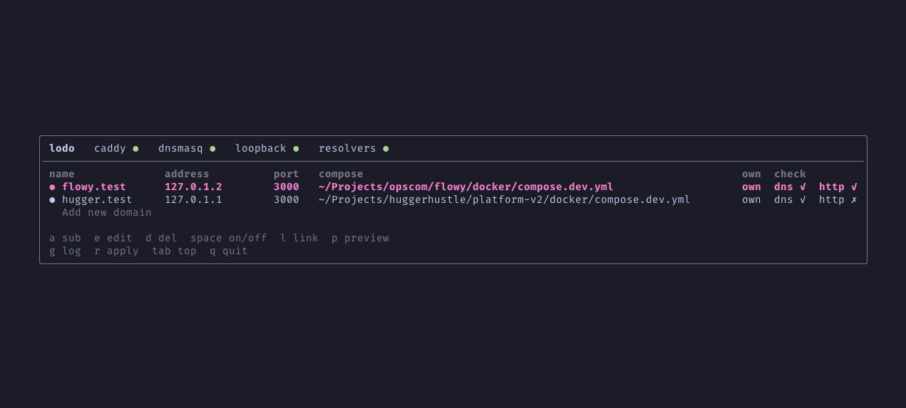

# lodo

Run multiple projects on one Mac at once, each database and app on its usual port. Every project gets its own
loopback address (`127.0.1.x`) and a `.lodo` (or custom) domain name, backed by dnsmasq, `/etc/resolver`, and Caddy.



```text
media.lodo -> 127.0.1.3 -> 127.0.1.3:5432 (Postgres), 127.0.1.3:3000 (Next)
blog.lodo  -> 127.0.1.1 -> 127.0.1.1:5432 (Postgres)
http://dashboard.blog.lodo -> Caddy on port 80 -> 127.0.1.1:3000
```

## Quick start

Requires macOS on Apple Silicon with Homebrew in `/opt/homebrew`, Go 1.27+, and an admin account (untested on Linux,
though straightforward to adapt).

```sh
# 1. Install dependencies and lodo (caddy is only needed for names with a port)
brew install dnsmasq caddy
go install github.com/sangdth/lodo/cmd/lodo@master  # ensure ~/go/bin is on your PATH

# 2. Start a project (runs one-time Mac setup and the project form on first use)
cd ~/Projects/shop
lodo dev

# 3. Open the dashboard to view and manage all domains
lodo ps
```

For Docker Compose, bind ports with `"${DOCKER_HOST_IP:-127.0.0.1}:5432:5432"`. `lodo dev` and `lodo exec` export
`DOCKER_HOST_IP` and your project's `.env` URLs automatically without editing any project file.

Something broken? Run `lodo doctor` first.

## Documentation

- [Setup & how it works](docs/reference.md#setup) — what one-time setup changes, rules, and uninstall
- [Using lodo & the dashboard](docs/reference.md#using-lodo) — `lodo dev`, `lodo exec`, worktrees, and dashboard keys
- [Commands](docs/reference.md#commands) — full CLI reference (`dev`, `exec`, `ps`, `menubar`, `scan`, `prune`, `doctor`, `update`)
- [HTTPS & sign-in callbacks](docs/reference.md#https) — local TLS certificates and OAuth (including Google sign-in)
- [Troubleshooting](docs/reference.md#troubleshooting) — common errors and fixes
- [Development](docs/development.md) — running tests, linting, building from source, and reinstalling locally
